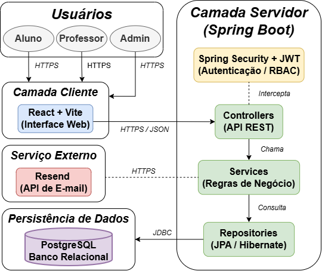

# MaisEdu

Plataforma web de **aprendizagem adaptativa de Matemática** para o Ensino Fundamental II (6º ao 9º ano), com **banco de questões compartilhado** entre instituições de ensino cadastradas.

> Projeto Final de Curso (PFC) — Bacharelado em Engenharia de Software, Universidade de Mogi das Cruzes (UMC).

## Sobre o projeto

O MaisEdu permite que professores criem questões de Matemática por tópico, nível de dificuldade e ano escolar, submetam-nas a uma **validação colaborativa por pares** (quórum de 3 votos em até 5) e, uma vez aprovadas, as usem — junto com as de outras escolas — em atividades para as suas turmas. As respostas dos alunos alimentam o **desempenho por tópico e nível**, que o **motor de prática adaptativa** usa para montar exercícios direcionados às maiores dificuldades de cada aluno.

## Funcionalidades

| Requisito | Funcionalidade | Perfil |
|---|---|---|
| RF01–RF03 | Login por cookie HttpOnly, troca da senha provisória com aceite dos termos, logout que invalida a sessão no servidor | Todos |
| RF04, RF05 | Cadastro de professores (senha por e-mail via Resend) e de alunos (sem e-mail) | Admin, Professor |
| RF06 | Cadastro e desativação de turmas | Admin |
| RF07, RF08 | Vínculo de professores e alunos às turmas (RN01) | Admin, Professor |
| RF09–RF11 | Questões com 5 alternativas, envio para validação e votação por quórum (RN02) | Professor |
| RF12, RF13 | Trilha de auditoria isolada por instituição, com tela de consulta | Admin |
| RF14 | Termos de Uso e Política de Privacidade, versionados (nova versão exige novo aceite) | Todos |
| RF15 | Atividades com questões aprovadas do banco compartilhado | Professor |
| RF16 | Resolução com snapshot das questões (RN03), resposta única e correção automática (RN04) | Aluno |
| RF17 | Desempenho acumulado por tópico e nível, atualizado a cada resposta (RN05) | Sistema |
| RF18 | Prática adaptativa (RN06) | Aluno |
| RF19 | Painel de desempenho do aluno e da turma, com evolução semanal | Aluno, Professor |
| LGPD | Redefinição de senha, correção, desativação, exportação (JSON) e anonimização de usuários; retenção automática dos logs | Admin |

## Arquitetura



- **Front-end**: SPA em React + Vite. Chama a API sempre em `/api` (proxy do Vite em desenvolvimento, nginx no Docker), então front e API ficam na mesma origem.
- **Back-end**: API REST em Spring Boot, em camadas Controller → Service → Repository. O motor adaptativo (`MotorAdaptativo`) é uma classe pura, sem Spring, testada isoladamente.
- **Autenticação**: Spring Security + JWT em cookie HttpOnly/SameSite=Strict, RBAC por papéis. A cada requisição o filtro confere no banco se a conta está ativa e se a sessão não foi encerrada.
- **Persistência**: PostgreSQL via Spring Data JPA / Hibernate; esquema evoluído só por migrations Flyway (`V1` a `V8`).
- **Serviço externo**: Resend, para os e-mails de senha provisória de professores e administradores (enviados só depois do commit).

## Como executar

### Opção 1 — Docker (um comando)

Requisito: Docker com Compose.

```bash
cp .env.example .env        # opcional: ajuste JWT_SECRET, RESEND_API_KEY etc.
docker compose up --build
```

- Sistema: **http://localhost:8081**
- API direta (Postman/Insomnia): http://localhost:8080

Por padrão roda no perfil **dev**, que popula um banco vazio com o cenário de demonstração (abaixo). Para zerar o banco: `docker compose down -v`.

### Opção 2 — Desenvolvimento local

Requisitos: Java 25, Node 22+, PostgreSQL com um banco `maisedu`.

```bash
# back-end
cd backend
cp .env.example .env          # preencha DB_PASSWORD e JWT_SECRET (o Spring lê este arquivo)
./mvnw spring-boot:run -Dspring-boot.run.profiles=dev

# front-end (outro terminal)
cd frontend
npm install
npm run dev                    # http://localhost:5173 (o Vite repassa /api para a porta 8080)
```

### Cenário de demonstração (perfil `dev`)

Criado só quando o banco está vazio. Todos os dados são fictícios. Senha de todas as contas: **`MaisEdu@2026`**.

| Conta | Perfil |
|---|---|
| `admin.a@maisedu.dev` | Administrador (e professor) da Escola Estadual Monteiro Lobato |
| `ana@maisedu.dev` | Professora do 7º ano A |
| `bruno@maisedu.dev` | Professor do 6º ano B |
| `admin.b@maisedu.dev` | Administrador do Colégio Municipal Cecília Meireles |
| `carla@maisedu.dev` | Professora do 8º ano C (outra escola) |
| `diego@maisedu.dev` | Professor sem turma (outra escola) |
| `a7001` … `a7006` | Alunos do 7º ano A (`a7006` ainda não fez nada) |
| `a6001` … `a6004`, `b8001` … `b8004` | Alunos do 6º ano B e do 8º ano C |
| `elisa@maisedu.dev`, `a7099` | Primeiro acesso: senha provisória **`Provisoria1`** |

Inclui 96 questões aprovadas (8 tópicos × 3 níveis, com gabarito calculado), questões pendentes na fila de validação, uma rejeitada, um rascunho, atividades respondidas em semanas diferentes e duas práticas adaptativas já feitas. Sem `RESEND_API_KEY`, o conteúdo dos e-mails aparece no log do back-end.

## Testes

```bash
cd backend
./mvnw test
```

- **Unitários** (JUnit 5 + Mockito): entidades e regras de negócio — RN01 a RN06, autenticação, LGPD, motor adaptativo.
- **Integração** (`@SpringBootTest` + H2): fluxos HTTP reais — login, questões, quórum, fluxo completo turma → atividade → respostas → desempenho → prática adaptativa, revogação de sessão, isolamento da auditoria e novo aceite dos termos.

> Os testes de integração usam H2 com o Flyway desligado; as restrições específicas do PostgreSQL das migrations (EXCLUDE, trigger da RN04, CHECKs) não são exercitadas por eles.

## Estrutura do repositório

```
maisedu/
├── backend/            # API REST (Spring Boot) — Dockerfile próprio
│   └── src/main/resources/db/migration/   # V1..V8 (Flyway)
├── frontend/           # SPA (React + Vite) — Dockerfile + nginx.conf
├── docs/
│   ├── diagrams/       # arquitetura e diagrama entidade-relacionamento
│   ├── integracao-resend.md
│   ├── ALTERACOES.md   # o que mudou nesta versão e como foi verificado
│   └── AJUSTES_MONOGRAFIA.md
├── docker-compose.yml
└── .env.example
```

## Variáveis de ambiente (back-end)

| Variável | Uso |
|---|---|
| `DB_URL`, `DB_USERNAME`, `DB_PASSWORD` | Conexão com o PostgreSQL |
| `JWT_SECRET` | Segredo do JWT (mínimo 32 bytes; a aplicação não sobe com menos) |
| `JWT_COOKIE_SECURE` | `true` atrás de HTTPS |
| `RESEND_API_KEY`, `RESEND_REMETENTE` | E-mail transacional. Com `onboarding@resend.dev`, o Resend só entrega para o e-mail dono da conta; para outros destinatários, verifique um domínio |
| `CORS_ORIGENS` | Só se o front chamar a API em outra origem |
| `FORWARD_HEADERS_STRATEGY` | `native` atrás de proxy reverso (o compose já define) |

Parâmetros de negócio (em `application.properties`): versão vigente dos termos, retenção da auditoria (365 dias) e parâmetros do motor adaptativo (3 tópicos, 10 questões, 5 respostas, 70%).

## Equipe

- Gustavo André dos Passos Chelucci
- Zacarias Alves Lins

## Licença

Projeto acadêmico desenvolvido para fins de Projeto Final de Curso (PFC) da UMC.
