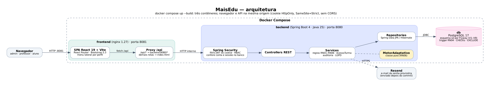

# MaisEdu

Plataforma web de **aprendizagem adaptativa de Matemática** para o Ensino Fundamental II (6º ao 9º ano), com **banco de questões compartilhado** entre instituições de ensino cadastradas.

> Projeto Final de Curso (PFC) — Bacharelado em Engenharia de Software, Universidade de Mogi das Cruzes (UMC).

## Sobre o projeto

O MaisEdu permite que professores criem questões de Matemática por tópico, nível de dificuldade e ano escolar, submetam-nas a uma **validação colaborativa por pares** (quórum de 3 votos em até 5) e, uma vez aprovadas, as usem — junto com as de outras escolas — em atividades para as suas turmas. As respostas dos alunos alimentam o **desempenho por tópico e nível**, que o **motor de prática adaptativa** usa para montar exercícios direcionados às maiores dificuldades de cada aluno.

## Funcionalidades

| Requisito | Funcionalidade | Perfil |
|---|---|---|
| RF01–RF03 | Login por cookie HttpOnly, troca da senha provisória com aceite dos termos, logout que invalida a sessão no servidor | Todos |
| RF04, RF05 | Cadastro de professores (senha por e-mail via Resend) e de alunos (sem e-mail, com login gerado pelo sistema e acesso enviado ao e-mail do responsável), já podendo escolher a turma; a tela avisa quando o e-mail de acesso não foi entregue | Admin, Professor |
| RF06 | Cadastro e desativação de turmas | Admin |
| RF07, RF08 | Tela da Turma: professores e alunos, vincular e desvincular (RN01) | Admin, Professor |
| RF09–RF11 | Questões com 5 alternativas (rascunho editável), envio para validação e votação por quórum com motivo da rejeição e placar para o autor (RN02) | Professor |
| RF12, RF13 | Trilha de auditoria isolada por instituição, com tela de consulta (filtro de usuário com busca no servidor) | Admin |
| RF14 | Termos de Uso e Política de Privacidade, versionados (nova versão exige novo aceite) | Todos |
| RF15 | Banco de questões compartilhado (com escola de origem) e atividades com as questões aprovadas e prazo de entrega (alterável antes de terminar); resultados com o erro mais comum de cada questão | Professor |
| RF16 | Resolução com snapshot das questões (RN03): o aluno marca e troca alternativas e envia tudo de uma vez, só com todas respondidas (RN04); a correção aparece depois do prazo (na prática, logo após o envio) | Aluno |
| RF17 | Desempenho acumulado por tópico e nível (RN05), contado uma única vez: na prática, no envio; na atividade, no fechamento automático do prazo | Sistema |
| RF18 | Tela Praticar: prática recomendada pelo motor (RN06, com diagnóstica para quem não respondeu nada) e cards por tópico para praticar o tópico escolhido | Aluno |
| RF19 | Painel do aluno e da turma (mapa de calor aluno × tópico, evolução semanal, efeito da prática) e painel da escola para o administrador, só com números agregados (grupos com menos de 3 alunos aparecem como "poucos dados") | Aluno, Professor, Admin |
| LGPD | Lista de usuários paginada com busca; redefinição de senha, correção, desativação, exportação (JSON) e anonimização de usuários; retenção automática dos logs | Admin |
| LGPD | Minha conta: dados, troca de senha, aceite dos termos e "baixar meus dados" pelo próprio titular | Todos |
| — | Página Início por perfil, menu lateral, "Como funciona" | Todos |

## Arquitetura



- **Front-end**: SPA em React + Vite, com React Router (uma rota por tela, o Voltar do navegador funciona) e Bootstrap 5.3. Menu lateral por perfil (gaveta no celular). Chama a API sempre em `/api` (proxy do Vite em desenvolvimento, nginx no Docker), então front e API ficam na mesma origem.
- **Back-end**: API REST em Spring Boot, em camadas Controller → Service → Repository. A regra de acesso à turma fica num lugar só (`AcessoTurma`). O motor adaptativo (`MotorAdaptativo`) é uma classe pura, sem Spring, testada isoladamente, e um único bean dele serve a prática e o painel de desempenho.
- **Autenticação**: Spring Security + JWT em cookie HttpOnly/SameSite=Strict, RBAC por papéis. A cada requisição o filtro confere no banco se a conta está ativa e se a sessão não foi encerrada.
- **Persistência**: PostgreSQL via Spring Data JPA / Hibernate; esquema evoluído só por migrations Flyway (`V1` a `V11`). Modelo de dados: [docs/diagrams/er_diagram.png](docs/diagrams/er_diagram.png).
- **Serviço externo**: Resend, para os e-mails de senha provisória: de professores e administradores para o próprio e-mail; de alunos, para o e-mail do responsável (enviados só depois do commit). O resultado do envio (enviado, falhou, envio desativado) fica gravado no usuário para a tela avisar.
- **Tarefas agendadas**: o fechamento das atividades vencidas (a cada minuto: contabiliza o desempenho das respostas enviadas e libera a correção) e a retenção da auditoria (diária). Os horários usam o fuso do servidor; o compose define `TZ=America/Sao_Paulo`.

## Como executar

### Opção 1 — Docker (um comando)

Requisito: Docker com Compose.

```bash
cp .env.example .env        # opcional: ajuste JWT_SECRET, RESEND_API_KEY etc.
docker compose up --build
```

- Sistema: **http://localhost:8081**
- API direta (Postman/Insomnia): http://localhost:8080

Por padrão roda no perfil **dev**, que popula um banco vazio com o cenário de demonstração (abaixo). Para zerar o banco: `docker compose down -v`.

### Opção 2 — Desenvolvimento local

Requisitos: Java 25, Node 22+, PostgreSQL com um banco `maisedu`.

```bash
# back-end
cd backend
cp .env.example .env          # preencha DB_PASSWORD e JWT_SECRET (o Spring lê este arquivo)
./mvnw spring-boot:run -Dspring-boot.run.profiles=dev

# front-end (outro terminal)
cd frontend
npm install                    # na primeira vez e sempre que o package.json mudar
npm run dev                    # http://localhost:5173 (o Vite repassa /api para a porta 8080)
```

### Cenário de demonstração (perfil `dev`)

Criado só quando o banco está vazio. Todos os dados são fictícios. Senha de todas as contas: **`MaisEdu@2026`**.

| Conta | Perfil |
|---|---|
| `admin.a@maisedu.dev` | Administrador (e professor) da Escola Estadual Monteiro Lobato |
| `ana@maisedu.dev` | Professora do 7º ano A |
| `bruno@maisedu.dev` | Professor do 6º ano B |
| `admin.b@maisedu.dev` | Administrador do Colégio Municipal Cecília Meireles |
| `carla@maisedu.dev` | Professora do 8º ano C (outra escola) |
| `diego@maisedu.dev` | Professor sem turma (outra escola) |
| `a7001` … `a7006` | Alunos do 7º ano A (`a7006` ainda não fez nada: a prática recomendada é a diagnóstica) |
| `a6001` … `a6004`, `b8001` … `b8004` | Alunos do 6º ano B e do 8º ano C |
| `elisa@maisedu.dev`, `a7099` | Primeiro acesso: senha provisória **`Provisoria1`** |

Inclui 96 questões aprovadas (8 tópicos × 3 níveis, com gabarito calculado), questões pendentes na fila de validação, uma rejeitada, um rascunho, atividades já encerradas e corrigidas em semanas diferentes, práticas adaptativas já feitas (para o "efeito da prática") e uma atividade ainda no prazo ("Porcentagem e média"), com alunos que já entregaram, um com respostas marcadas e não enviadas e outros que nem começaram. Os alunos do seed têm logins fixos para facilitar a demonstração; alunos cadastrados pela tela recebem um login gerado (ex.: `a482913`). Cada aluno do seed tem como e-mail do responsável `responsavel.<login>@maisedu.dev` (endereço fictício). Sem `RESEND_API_KEY`, o conteúdo dos e-mails (inclusive a senha provisória enviada ao responsável) aparece no log do back-end.

### Escola de volume para os painéis (perfil `demo-volume`)

Para mostrar os painéis com números realistas, acrescente o perfil `demo-volume` (`SPRING_PROFILES_ACTIVE=dev,demo-volume` no `.env` do compose, ou `-Dspring-boot.run.profiles=dev,demo-volume` no Maven). Num banco vazio, ele cria, além do cenário acima, a **Escola Estadual Portal do Saber (fictícia)**: 30 turmas do 6º ao 9º ano, 12 professores, 1000 alunos simulados com respostas distribuídas em várias semanas, práticas adaptativas e uma atividade aberta por turma. Contas: `admin.c@maisedu.dev` e `prof01.c@maisedu.dev` … `prof12.c@maisedu.dev`, com a mesma senha. A carga usa inserções em lote e leva alguns segundos na primeira subida.

> Os dados de volume são simulados: servem para ver os painéis funcionando, não como evidência de resultado pedagógico.

## Testes

```bash
cd backend
./mvnw test
```

- **Unitários** (JUnit 5 + Mockito): entidades e regras de negócio — RN01 a RN06, autenticação, LGPD, motor adaptativo.
- **Integração** (`@SpringBootTest` + H2): fluxos HTTP reais — login, questões, quórum, fluxo completo turma → atividade com prazo → marcação e envio → fechamento no prazo → correção e desempenho → prática adaptativa (recomendada e por tópico), painel da escola com minimização, lista paginada de usuários, revogação de sessão, isolamento da auditoria e novo aceite dos termos.

> Os testes de integração usam H2 com o Flyway desligado; as restrições específicas do PostgreSQL das migrations (EXCLUDE, trigger da RN04, CHECKs) não são exercitadas por eles.

## Estrutura do repositório

```
maisedu/
├── backend/            # API REST (Spring Boot) — Dockerfile próprio
│   └── src/main/resources/db/migration/   # V1..V11 (Flyway)
├── frontend/           # SPA (React + Vite) — Dockerfile + nginx.conf
├── docs/
│   ├── diagrams/       # arquitetura e diagrama entidade-relacionamento (PNG + fonte .dot)
│   ├── integracao-resend.md
│   ├── ALTERACOES.md   # o que mudou nesta versão e como foi verificado
│   └── AJUSTES_MONOGRAFIA.md
├── docker-compose.yml
└── .env.example
```

## Variáveis de ambiente (back-end)

| Variável | Uso |
|---|---|
| `DB_URL`, `DB_USERNAME`, `DB_PASSWORD` | Conexão com o PostgreSQL |
| `JWT_SECRET` | Segredo do JWT (mínimo 32 bytes; a aplicação não sobe com menos) |
| `JWT_COOKIE_SECURE` | `true` atrás de HTTPS |
| `RESEND_API_KEY`, `RESEND_REMETENTE` | E-mail transacional. Com `onboarding@resend.dev`, o Resend só entrega para o e-mail dono da conta; para outros destinatários, verifique um domínio |
| `APP_URL` | Endereço do sistema usado nos links dos e-mails (padrão `http://localhost:8081`) |
| `CORS_ORIGENS` | Só se o front chamar a API em outra origem |
| `FORWARD_HEADERS_STRATEGY` | `native` atrás de proxy reverso (o compose já define) |

| `SPRING_PROFILES_ACTIVE` | `dev` (cenário de demonstração); `dev,demo-volume` acrescenta a escola de volume |
| `TZ` | Fuso do servidor, usado nos prazos e no fechamento das atividades (padrão do compose: `America/Sao_Paulo`) |

Parâmetros de negócio (em `application.properties`): versão vigente dos termos (3), retenção da auditoria (365 dias), parâmetros do motor adaptativo (3 tópicos, 10 questões, 5 respostas, 70%; 5 questões na prática de um tópico) e intervalo do fechamento das atividades vencidas (60 s).

## Equipe

- Gustavo André dos Passos Chelucci
- Zacarias Alves Lins

## Licença

Projeto acadêmico desenvolvido para fins de Projeto Final de Curso (PFC) da UMC.
